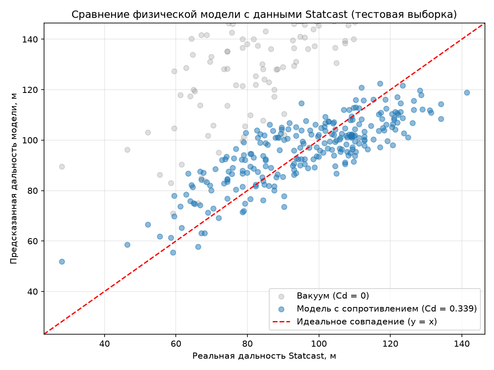

# Баллистический калькулятор и проверка модели по данным Statcast

Учебный проект по моделированию полёта тела с квадратичным сопротивлением воздуха и проверке физической модели на открытых данных бейсбольных ударов(**Statcast**).

---

## 1. Физическая модель и численные методы

Движение материальной точки массой \(m\) в однородном поле тяжести с квадратичным аэродинамическим сопротивлением описывается системой ОДУ:

* **Метод RK4 (`ballistics.physics.simulate`):** метод Рунге-Кутты 4-го порядка с фиксированным шагом `dt` и линейной интерполяцией момента касания земли (\(y = 0\)).
* **Метод `solve_ivp` (`ballistics.physics.simulate_ivp`):** расчёт через `scipy.integrate.solve_ivp` с терминальным событием падения `hit_ground`.
* **Верификация и сходимость:** расчёт в вакууме (\(C_d = 0\)) сверен с аналитическим решением (`analytical_vacuum`). В тесте `test_rk4_convergence_order` проверяется монотонное убывание ошибки при уменьшении шага `dt`, а скрипт `docs/plot_convergence.py` строит график сходимости в логарифмическом масштабе:


---

## 2. Проверка модели по данным Statcast

Для проверки модели использованы реальные данные MLB Statcast (библиотека `pybaseball`) за период `2024-06-01` — `2024-06-07` (после фильтрации получено **1267** флай-болов):
1. Отобраны только флай-болы (`bb_type == "fly_ball"`) с корректными значениями `launch_speed`, `launch_angle`, `hit_distance_sc`.
2. Величины переведены из имперских единиц в СИ: `v0_ms = launch_speed * 0.44704`, `distance_m = hit_distance_sc * 0.3048`.
3. Параметры бейсбольного мяча: \(m = 0.145\text{ кг}\), \(A = \pi \cdot 0.037^2 \approx 0.0043\text{ м}^2\), \(h_0 = 1.0\text{ м}\), \(\rho = 1.225\text{ кг/м}^3\), \(g = 9.81\text{ м/с}^2\).

### Калибровка \(C_d\) и ошибка на тестовой выборке

Выборка разделена в пропорции **80% / 20%** (`train = 1013`, `test = 254`). Подбор коэффициента сопротивления \(C_d\) выполнен методом наименьших квадратов (`scipy.optimize.least_squares`).

| Модель | MAE (тест), м | RMSE (тест), м | Среднее смещение (Bias), м |
| :--- | :---: | :---: | :---: |
| Вакуум (\(C_d = 0.0\)) | 62.80 | 66.79 | +62.80 |
| Гладкий шар (\(C_d = 0.47\)) | 13.60 | 16.49 | -11.81 |
| **Откалиброванный мяч (\(C_d = 0.3392\))** | **9.62** | **11.33** | **-0.37** |



**Вывод:** без учёта сопротивления воздуха модель завышает дальность флай-болов в среднем на **62.8 м**. Табличный коэффициент гладкой сферы (\(C_d = 0.47\)) даёт недолёт 11.8 м. Калибровка по данным Statcast даёт \(C_d = 0.3392\), убирает систематическое смещение (`Bias = -0.37 м`) и снижает среднюю ошибку до **9.62 м**. Оставшаяся погрешность объясняется отсутствием в модели эффекта Магнуса (вращения мяча), ветра и высоты стадионов.

---

## 3. Структура проекта

```text
ballistics/
├── .github/workflows/ci.yml   # Автозапуск ruff и pytest в GitHub Actions
├── data/                      # Локальная папка для CSV (исключена из Git)
├── docs/                      # Скрипты экспериментов и сохранённые графики
├── src/ballistics/
│   ├── physics.py             # RK4, solve_ivp, аналитика вакуума, поиск угла
│   ├── statcast.py            # Загрузка Statcast, проверка столбцов, перевод в СИ
│   ├── fitting.py             # Подбор Cd через least_squares и расчёт ошибок
│   ├── cli.py                 # Интерфейс командной строки (argparse)
│   └── gui.py                 # Графический интерфейс на Tkinter
├── tests/                     # Автоматические тесты pytest
└── pyproject.toml             # Зависимости и настройки пакета
```

---

## 4. Установка и запуск

### Установка
```bash
git clone https://github.com
cd ballistics
pip install -e ".[dev]"
```

### Командная строка (CLI)
Файлы `data/*.csv` не хранятся в репозитории (добавлены в `.gitignore`), поэтому перед калибровкой нужно сначала загрузить данные командой `fetch`:

```bash
# 1. Скачать и очистить флай-болы за выбранные даты
ballistics fetch --start 2024-06-01 --end 2024-06-07 --out data/fly_balls_clean.csv

# 2. Подобрать Cd на train и вывести таблицу ошибок на test
ballistics fit --data data/fly_balls_clean.csv

# 3. Рассчитать траекторию одного броска (solver: rk4 или ivp)
ballistics simulate --v0 45 --angle 28 --cd 0.3392 --solver rk4

# 4. Найти угол максимальной дальности
ballistics optimal-angle --v0 45 --cd 0.3392
```

### Графический интерфейс (Tkinter)
```bash
python -m ballistics.gui
```

---

## 5. Документация API

* `ballistics.physics.simulate(v0, angle, h0, mass, cd, area, rho, g, use_drag, dt=0.005, max_time=300.0)` — численное интегрирование траектории методом RK4.
* `ballistics.physics.simulate_ivp(v0, angle, h0, mass, cd, area, rho, g, use_drag, max_time=300.0)` — интегрирование через `scipy.integrate.solve_ivp` с событием касания земли `hit_ground`.
* `ballistics.physics.analytical_vacuum(v0, angle, h0=0.0, g=9.81)` — точное аналитическое решение для полёта в вакууме.
* `ballistics.physics.find_optimal_angle(v0, h0=0.0, mass=0.145, cd=0.35, area=0.0043, rho=1.225, g=9.81, use_drag=True, dt=0.01)` — поиск угла вылета для максимальной дальности через `scipy.optimize.minimize_scalar`.
* `ballistics.statcast.fetch_statcast_data(start_dt, end_dt, save_path=None)` — загрузка данных Statcast через `pybaseball`.
* `ballistics.statcast.inspect_columns(df)` — проверка наличия, типов и диапазонов значений столбцов в таблице.
* `ballistics.statcast.prepare_fly_balls(df)` — отбор флай-болов и перевод скорости и дальности в СИ.
* `ballistics.fitting.split_train_test(df, train_ratio=0.8)` — разделение выборки на обучающую и тестовую части.
* `ballistics.fitting.fit_cd(train_df, initial_cd=0.40, h0=1.0, mass=0.145, area=0.0043, rho=1.225, g=9.81, dt=0.01)` — подбор $C_d$ методом наименьших квадратов.
* `ballistics.fitting.evaluate_models(train_df, test_df, fitted_cd, dt=0.01)` — оценка моделей по метрикам `MAE`, `RMSE` и `Bias` на тестовой выборке.

---

## 6. Тестирование и CI

```bash
ruff check .
pytest -v
```
Автоматическая проверка линтером `ruff` и тестами `pytest` настроена в файле `.github/workflows/ci.yml`.

