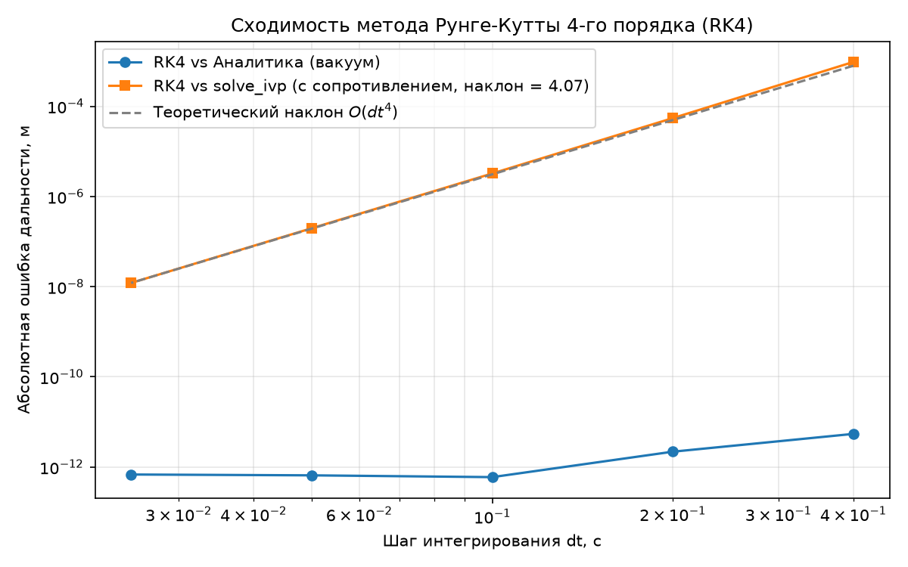

# ballistics
# Баллистический калькулятор и проверка модели по данным Statcast

Учебный научно-инженерный проект по моделированию полёта тела с квадратичным сопротивлением воздуха и проверке физической модели на реальных данных трекинга бейсбольных ударов MLB (**Statcast**).

---

## 1. Физическая модель

Движение материальной точки массой $m$ в однородном поле тяжести с учётом квадратичного аэродинамического сопротивления описывается системой дифференциальных уравнений:

$$
\begin{cases}
\dot{x} = v_x \\
\dot{y} = v_y \\
\dot{v}_x = -k \cdot \|v\| \cdot v_x \\
\dot{v}_y = -g - k \cdot \|v\| \cdot v_y
\end{cases}
\quad \text{где } k = \frac{\rho C_d A}{2m}, \quad \|v\| = \sqrt{v_x^2 + v_y^2}.
$$

* **Численные методы:** реализован собственный решатель методом Рунге-Кутты 4-го порядка (**RK4**) с линейной интерполяцией момента касания земли ($y = 0$), а также эталонный решатель через `scipy.integrate.solve_ivp` с терминальным событием падения (`hit_ground`).
* **Верификация и сходимость:** точность решения в вакууме ($C_d = 0$) проверена по аналитическим формулам. График зависимости ошибки дальности от шага интегрирования $dt$ подтверждает теоретический 4-й порядок точности $O(dt^4)$:



---

## 2. Проверка на реальных данных Statcast

Для оценки точности модели использованы реальные данные MLB (система Statcast, пакет `pybaseball`) за период `2024-06-01` — `2024-06-07` (**1267** чистых флай-болов):
1. Отобраны только флай-болы (`bb_type == "fly_ball"`), так как граунд-болы катятся по полю.
2. Проверены реальные названия и диапазоны столбцов (`launch_speed`, `launch_angle`, `hit_distance_sc`).
3. Выходные параметры переведены из имперских единиц в СИ (`mph` $\to$ `м/с`, `ft` $\to$ `м`).
4. Параметры бейсбольного мяча: $m = 0.145\text{ кг}$, $A = 0.0043\text{ м}^2$, высота удара $h_0 = 1.0\text{ м}$, $\rho = 1.225\text{ кг/м}^3$.

### Результаты калибровки $C_d$ (`least_squares`)

Выборка разделена в пропорции **80% / 20%** (`train = 1013`, `test = 254`). Подбор $C_d$ выполнен методом наименьших квадратов (`scipy.optimize.least_squares`).

| Модель | MAE (тест), м | RMSE (тест), м | Среднее смещение (Bias), м |
| :--- | :---: | :---: | :---: |
| Вакуум ($C_d = 0.0$) | 62.80 | 66.79 | +62.80 |
| Гладкий шар ($C_d = 0.47$) | 13.60 | 16.49 | -11.81 |
| **Откалиброванный мяч ($C_d = 0.3392$)** | **9.62** | **11.33** | **-0.37** |


**Вывод:** без учёта сопротивления воздуха модель переоценивает дальность полёта в среднем на **62.8 м**. Табличное значение для гладкой сферы ($C_d = 0.47$) завышает торможение (недолёт 11.8 м), тогда как калибровка по данным Statcast даёт физически обоснованное значение **$C_d = 0.3392$**, убирает систематическое смещение (`Bias = -0.37 м`) и снижает среднюю ошибку до **9.62 м**. Оставшийся разброс объясняется неучтённым вращением мяча (эффектом Магнуса), ветром и высотой конкретных стадионов.

---

## 3. Установка и примеры использования

### Установка пакета
```bash
pip install -e ".[dev]"
```

### Командная строка (CLI)
```bash
# 1. Скачать и очистить флай-болы за выбранные даты
ballistics fetch --start 2024-06-01 --end 2024-06-07 --out data/fly_balls_clean.csv

# 2. Подобрать Cd на обучающей выборке и оценить ошибку в метрах на тесте
ballistics fit --data data/fly_balls_clean.csv

# 3. Рассчитать траекторию одного броска (метод rk4 или ivp)
ballistics simulate --v0 45 --angle 28 --cd 0.3392 --solver rk4

# 4. Найти угол максимальной дальности (дополнительная задача)
ballistics optimal-angle --v0 45 --cd 0.3392
```

### Графический интерфейс (Tkinter GUI)
```bash
python -m ballistics.gui
```

---

## 4. Документация API

* `ballistics.physics.simulate(v0, angle, h0, mass, cd, area, rho, g, use_drag, dt=0.005)` — расчёт траектории методом RK4; возвращает словарь с массивами координат `x`, `y` и итоговыми метриками (`time`, `range`, `max_height`, `impact_speed`, `impact_angle`).
* `ballistics.physics.simulate_ivp(...)` — расчёт траектории через `scipy.integrate.solve_ivp` с терминальным событием касания земли (`y = 0`).
* `ballistics.physics.analytical_vacuum(v0, angle, h0=0.0, g=9.81)` — точные аналитические формулы полёта в вакууме.
* `ballistics.physics.find_optimal_angle(...)` — поиск угла вылета для максимальной дальности через `scipy.optimize.minimize_scalar`.
* `ballistics.statcast.fetch_statcast_data(start_dt, end_dt, save_path=None)` — загрузка сырых данных MLB Statcast.
* `ballistics.statcast.prepare_fly_balls(df)` — фильтрация флай-болов и перевод единиц измерения в СИ.
* `ballistics.fitting.fit_cd(train_df, ...)` — подбор коэффициента сопротивления $C_d$ методом `scipy.optimize.least_squares`.
* `ballistics.fitting.evaluate_models(train_df, test_df, fitted_cd)` — оценка ошибок `MAE`, `RMSE` и `Bias` в метрах на тестовой выборке.

---

## 5. Тестирование и CI

```bash
ruff check .
pytest -v
```
Автоматическая проверка линтером `ruff` и тестами `pytest` настроена в `.github/workflows/ci.yml`.
